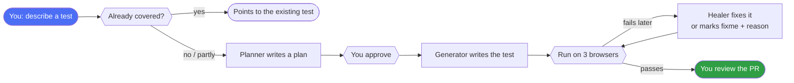

# PromtDrivenAutomation_JavaScript

[](https://github.com/nitesh00747/PromtDrivenAutomation_JavaScript/actions/workflows/playwright.yml)
[](https://playwright.dev)
[](https://www.typescriptlang.org/)

**Describe a test in plain English. AI agents check it isn't already covered, plan it, write it in
Playwright and fix it when it breaks. You approve the plan and review the PR.**

Built on Playwright's official test agents, with the guardrails a real team needs around them.
Demonstrated on [SauceDemo](https://www.saucedemo.com/); point it at your own app in four steps.

## How it works



Your part: say what to test, approve the plan, review the PR. Nothing is generated without your
approval.

## Quick start

```powershell
npm install
npx playwright install chromium
copy .env.example .env   # optional: BASE_URL for dev / QA / UAT
npm test                 # all browsers; npm run test:ui for the interactive view
```

Then, in Claude Code: *"Write a test that a locked-out user sees an error message."* The coverage
checker runs first, then the Planner, then you approve. Works on Windows, macOS and Linux.

## What keeps it trustworthy

| Guardrail | What it does |
|---|---|
| **Plan approval** | A person approves every plan before a test is generated |
| **Coverage check** | An agent reads `specs/manifest.json` (an auto-generated index of every test) so the same test isn't written twice |
| **Conventions, enforced** | Tests use page objects and fixtures, with no hard-coded URLs, passwords or hard waits. [`TESTING-CONVENTIONS.md`](TESTING-CONVENTIONS.md) sets the rules; `npm run guardrails` fails CI on a break, an unexplained skip or a stale index |
| **No retries** | A retry hides a flaky test. A [nightly job](.github/workflows/flakiness.yml) runs the suite 5 times and [Flake Forensics](https://github.com/nitesh00747/flake-forensics) explains any flakiness |
| **Review gate** | CODEOWNERS plus a PR checklist on everything agents write ([details](CONTRIBUTING.md#review-gate)) |
| **Metrics** | `npm run metrics`: pass rate, slowest tests, and how many generated tests survive review |

## How the tests are built

| Piece | Where |
|---|---|
| Page objects (every locator in one place) | `pages/` |
| Fixtures (`loginPage`, `inventoryPage`, `cartPage`, ...) | `fixtures/` |
| Log in once per run, saved for all tests | `tests/auth.setup.ts` |
| Users, password and products, overridable from `.env` | `test-data/`, `pages/products.ts` |
| Plans (plain English) and the test index | `specs/` |
| Tests, one scenario per file | `tests/` |
| The agents and the `playwright-cli` skill | `.claude/` |

Tests can be generated two ways: the **Generator** agent (through MCP, the default) or the
**`playwright-cli-generator`** agent (through `playwright-cli`, handy for scripted runs). Both write
the same kind of test. Planning and healing always use MCP.

## What's covered

| Plan | Covers |
|---|---|
| [login-and-inventory](specs/login-and-inventory.plan.md) | Accepted and rejected logins, inventory, product detail, sorting, logout, reset app state |
| [shopping-flow](specs/shopping-flow.plan.md) | Add/remove from cart, cart page, full checkout |
| [negative-edge-cases](specs/negative-edge-cases.plan.md) | Checkout validation, cancel flows, pages that need a login |

38 tests on chromium, firefox and webkit. One known SauceDemo bug (`problem_user` sees broken
images) is kept as a documented `test.fixme()`.

## Use it on your own app

1. Set `BASE_URL` in `.env` or your CI variables.
2. Make `tests/auth.setup.ts` log in to your app, and `tests/seed.spec.ts` open its first page.
3. Replace the page objects in `pages/`; the Generator adds to them as it goes.
4. Describe, approve, generate, run.

The agents, guardrails, metrics and CI carry over unchanged.

## More

[CONTRIBUTING.md](CONTRIBUTING.md): the approval workflow, running several Generators at once,
the merge checklist, review gate and metrics log.
[TESTING-CONVENTIONS.md](TESTING-CONVENTIONS.md): how every test is written.
