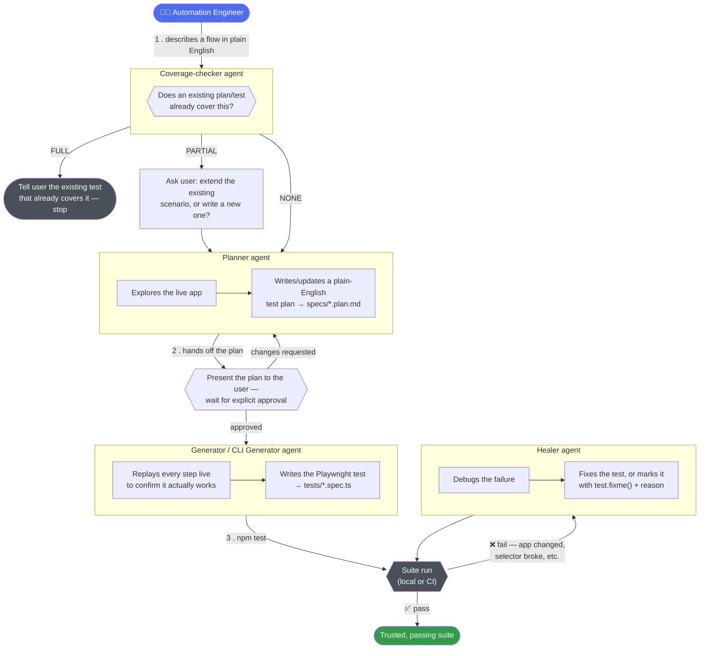
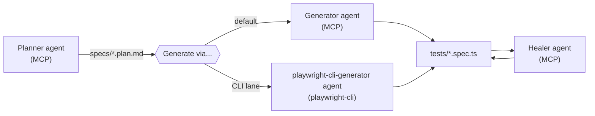

# PromtDrivenAutomation_JavaScript

[](https://github.com/nitesh00747/PromtDrivenAutomation_JavaScript/actions/workflows/playwright.yml)
[](https://playwright.dev)
[](https://www.typescriptlang.org/)
[](https://nodejs.org/)

Describe a test flow in plain English, and a small team of agents check it's not already covered,
plan it, write it, and heal it when it breaks — no hand-written test code. The agents aren't tied
to one app; this repo demonstrates the pattern against [SauceDemo](https://www.saucedemo.com/), a
public practice site. Point it at your own app and the same workflow applies — see [Using this on your own application](#using-this-on-your-own-application).

(JS/TS sibling to the C#/NUnit `PromtDrivenAutomation` repo, built on Playwright's official agents.)

## How it works — from the automation engineer's seat

You never write Playwright code by hand. You describe a flow, a coverage check runs first, you
approve the resulting plan, and the agents carry it through test → self-healing suite:



The engineer's job is steps **1**, approving the plan, and **3**: say what to test, approve what
the Planner came up with, and run the suite. The coverage check, the plan/test writing, and the
healing loop are the agents' job — but a plan never moves to test generation without your
explicit go-ahead. See [CONTRIBUTING.md](CONTRIBUTING.md) for the full plan-time workflow policy.

## Getting started

```powershell
cd C:\PromtDrivenAutomation_JavaScript
npm install
npx playwright install chromium
copy .env.example .env   # optional: set BASE_URL (dev, QA, UAT...) and credentials
```

Works on Windows, macOS and Linux (the MCP server is started with `node`, not `cmd`).

## How the tests are built

| Piece | Where | What it gives you |
|---|---|---|
| Page objects | `pages/` | Every locator lives in one place: a UI change is one edit, not one per test |
| Fixtures | `fixtures/index.ts` | Tests ask for `loginPage`, `inventoryPage`, `cartPage`, `checkoutPage`, `header`, `productPage` |
| Saved login | `tests/auth.setup.ts` | Logs in once per run; tests start already logged in (`test.use({ storageState: NO_AUTH })` for logged-out tests) |
| Test data | `test-data/users.ts`, `pages/products.ts` | Users, password and products in one place, overridable from `.env` |
| Conventions | [`TESTING-CONVENTIONS.md`](TESTING-CONVENTIONS.md) | The rules the Generator and Healer follow; `npm run guardrails` enforces them |

## How to use this solution

1. **Describe a flow.** Say what you want tested in plain English.
2. **Coverage check.** The `playwright-coverage-checker` agent checks `specs/manifest.json` and
   existing plans first. Already fully covered → it names the test, done. Partially covered → it
   names the related scenario and you choose: extend it, or write a new one.
3. **Plan it.** If it's new, the Planner agent explores the app and saves a plan under `specs/`.
4. **Approve the plan.** The plan is presented back to you — nothing is generated until you
   explicitly approve it. See [CONTRIBUTING.md](CONTRIBUTING.md) for why this step always happens.
5. **Generate the test.** Ask the Generator (MCP) or `playwright-cli-generator` (CLI) agent to turn
   the approved plan into a test — see [Two lanes](#two-lanes-mcp-vs-cli). It re-runs every step
   live, then writes the test file under `tests/`.
6. **Run the suite.** `npm test` (or `npm run test:ui` for an interactive view, `npm run
   test:report` for the last HTML report).
7. **Heal breakage.** If a test fails later, ask the Healer agent to fix it. It debugs the
   failure and either fixes the test or marks it with a clear explanation if it can't.

## Two lanes: MCP vs CLI

There are two ways to turn a plan into a test. Planning and healing always go through MCP — both
need the shared browser session's live state (exploring the app, or stepping through a failure).
Generating a test can go through either lane:



- **MCP lane** — `playwright-test-planner`, `playwright-test-generator`, `playwright-test-healer`.
  The default, unmodified agents under `.claude/agents/`; the Generator here is the fallback if the
  CLI lane isn't available or desired.
- **CLI lane** — `playwright-cli-generator` (`.claude/agents/playwright-cli-generator.md`). Drives
  `playwright-cli` directly over a named persistent session (`playwright-cli -s=<app> ...`) instead
  of MCP browser tools, then runs the new test with `npx playwright test <file>`. Useful when you
  want test generation to run as a plain CLI step (e.g. scripted, or outside an MCP-enabled agent
  session). See `.claude/skills/playwright-cli/SKILL.md` for the full command set, and
  `npm run cli` / `npm run cli:close` as shortcuts.

Either lane produces the same kind of test file (same `// spec:` / `// seed:` headers, role-based
locators, one scenario per file), so `specs/manifest.json` and the Healer treat them identically.

## Cross-browser

Tests run against `chromium`, `firefox`, and `webkit` (see the `projects` list in
`playwright.config.js`). CI (`.github/workflows/playwright.yml`) runs the `test` job as a matrix
over all three, each uploading its own `playwright-report-<project>` artifact, with
`fail-fast: false` so one browser's failure doesn't cancel the others. Locally:

```powershell
npx playwright test --project=chromium --project=firefox --project=webkit
```

Each run writes three reports: the console list, the HTML report (`npm run test:report`) and
`test-results/junit.xml` for CI tools such as Azure DevOps.

## Flakiness

There are **no retries**: a retry turns a flaky test into a silent pass. Instead, the nightly
[flakiness workflow](.github/workflows/flakiness.yml) runs the suite five times and passes the
results to [Flake Forensics](https://github.com/nitesh00747/flake-forensics), which reports which
tests both passed and failed on the same code, and why. You can also start it by hand from the
Actions tab.

## Metrics

`npm run metrics` reports suite size, the last run (pass rate, slowest tests) and agent outcomes:
how many generated tests survive review and how often the Healer really fixes a test. Agent outcomes
come from `metrics/agent-runs.jsonl` (see [CONTRIBUTING.md](CONTRIBUTING.md#metrics)). CI adds the
report to each run's summary.

## Review gate

Agent-written tests and plans go through the same PR process as anything else, with two guardrails
specific to this repo:

- **`.github/CODEOWNERS`** requires review from `@nitesh00747` on `tests/`, `specs/`, `.claude/`,
  and `playwright.config.js` — the paths agents write to.
- **`.github/pull_request_template.md`** prompts every PR for: which agent/lane wrote the test, the
  plan file it implements, confirmation it ran locally on all 3 browsers, any `test.fixme()`
  acknowledged, and that the manifest was regenerated.

Branch protection (1 approving review, passing `guardrails` and `test` checks) is applied via `gh
api` by a repo admin — see [CONTRIBUTING.md](CONTRIBUTING.md); it's not something an agent runs.

This is a **merge-time** check on the finished diff — separate from the **plan-time** approval
gate in [How it works](#how-it-works--from-the-automation-engineers-seat): a human approves the
Planner's plan before generation even starts, then later reviews the resulting PR before it merges.

## Using this on your own application

None of the above is tied to one app. To retarget:

1. Set `BASE_URL` (in `.env` or your CI variables).
2. Rewrite `tests/auth.setup.ts` to log in to your app, and `tests/seed.spec.ts` to open the
   first page of your flows.
3. Replace the page objects in `pages/` with your app's pages (the Generator adds to them as it goes).
4. Plan, generate, run, heal — same steps, your app's flows.

Everything else (agents, manifest script, CI workflow) carries over unchanged.

## What's covered today

Three plans under `specs/`, each with generated tests under `tests/`:

| Plan | Covers |
|---|---|
| [login-and-inventory](specs/login-and-inventory.plan.md) | Accepted and rejected logins, inventory items, product detail, sorting, logout, reset app state |
| [shopping-flow](specs/shopping-flow.plan.md) | Add/remove from cart, cart page, full checkout |
| [negative-edge-cases](specs/negative-edge-cases.plan.md) | Checkout form validation, cancel flows, direct-URL access without login |

`tests/known-issues/` documents one intentional SauceDemo bug (`problem_user` sees the same broken
image for every product), marked `test.fixme()` with an acknowledged reason.

## Avoiding duplicate coverage

`specs/manifest.json` is an always-current index of every test and which plan produced it,
regenerated automatically before every `npm test` (or on demand via `npm run test:index`). The
`playwright-coverage-checker` agent reads it (plus the actual `specs/*.plan.md` files) before any
new planning happens — see step 2 in [How to use this solution](#how-to-use-this-solution).

## Project layout

| Path | Purpose |
|---|---|
| `specs/` | Test plans, written by the Planner as plain markdown |
| `specs/manifest.json` | Auto-generated index of all tests — see above |
| `tests/` | Generated tests, written by the Generator, one file per scenario |
| `tests/seed.spec.ts` | Starting point (inventory page, logged in) other scenarios build on |
| `tests/auth.setup.ts` | Logs in once and saves the session for all tests |
| `pages/`, `fixtures/`, `test-data/` | Page objects, the `test` fixture, users and products — see [How the tests are built](#how-the-tests-are-built) |
| `TESTING-CONVENTIONS.md` | Rules every test follows, enforced by `npm run guardrails` |
| `metrics/agent-runs.jsonl` | One line per agent run, read by `npm run metrics` |
| `.claude/agents/` | Planner/Generator/Healer (official, plus a short "project conventions" section) + `playwright-cli-generator` (CLI lane) + `playwright-coverage-checker` (plan-time coverage check) |
| `.claude/skills/` | `playwright-cli` skill (installed via `npx playwright-cli install --skills`) |
| `playwright.config.js` | `BASE_URL`, saved login, browsers (chromium/firefox/webkit), reporters, no retries |
| `.github/workflows/` | `playwright.yml` (every push and PR), `flakiness.yml` (nightly) |
| `.github/CODEOWNERS` | Requires `@nitesh00747` review on `tests/`, `specs/`, `.claude/`, `playwright.config.js` |
| `.github/pull_request_template.md` | PR checklist — see [Review gate](#review-gate) |

## Scaling past a handful of tests

Running the Generator on multiple scenarios at once, and deciding what's safe to merge, need real
guardrails once this grows — see [CONTRIBUTING.md](CONTRIBUTING.md) for the concurrency policy and
merge checklist.

## Status

All five agents (coverage-checker, Planner, Generator, `playwright-cli-generator`, Healer) are
installed and working against SauceDemo, across chromium, firefox and webkit. See
[What's covered today](#whats-covered-today).
