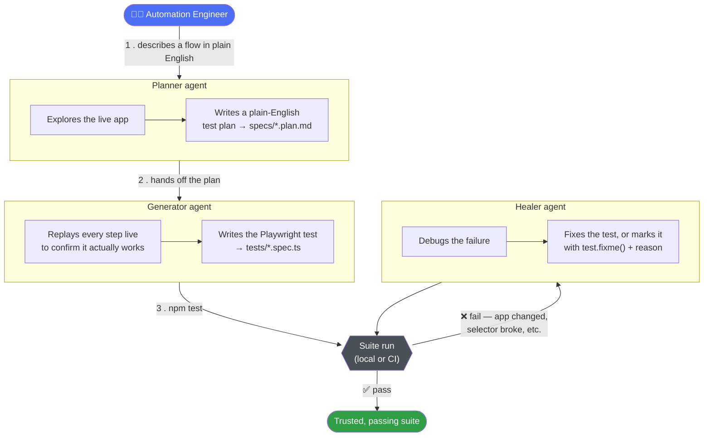

# PromtDrivenAutomation_JavaScript

[](https://github.com/nitesh00747/PromtDrivenAutomation_JavaScript/actions/workflows/playwright.yml)
[](https://playwright.dev)
[](https://www.typescriptlang.org/)
[](https://nodejs.org/)

Describe a test flow in plain English, and three Playwright agents plan it, write it, and heal it
when it breaks — no hand-written test code. The agents aren't tied to one app; this repo currently
targets [Assurant Renters Insurance](https://assurantrenters.com/) (Florida). Point it at your own
app and the same workflow applies — see [Using this on your own application](#using-this-on-your-own-application).

(JS/TS sibling to the C#/NUnit `PromtDrivenAutomation` repo, built on Playwright's official agents.)

## How it works — from the automation engineer's seat

You never write Playwright code by hand. You describe a flow, and the three agents carry it
through plan → test → self-healing suite:



The engineer's job is steps **1** and **3**: say what to test, and run the suite. Steps 2 and the
healing loop are the agents' job.

## Getting started

```powershell
cd C:\PromtDrivenAutomation_JavaScript
npm install
npx playwright install chromium
```

## How to use this solution

1. **Describe a flow.** Ask the Planner agent in plain English, e.g. "Use the
   playwright-test-planner agent to plan the checkout flow." It explores the app and saves a plan
   under `specs/`.
2. **Generate the test.** Ask the Generator agent to turn that plan into a test. It re-runs every
   step live, then writes the test file under `tests/`.
3. **Run the suite.** `npm test` (or `npm run test:ui` for an interactive view, `npm run
   test:report` for the last HTML report).
4. **Heal breakage.** If a test fails later, ask the Healer agent to fix it. It debugs the
   failure and either fixes the test or marks it with a clear explanation if it can't.

Before planning something new, check `specs/manifest.json` for existing coverage of that area —
see [Avoiding duplicate coverage](#avoiding-duplicate-coverage).

## Using this on your own application

None of the above is tied to one app. To retarget:

1. Change `baseURL` in `playwright.config.js`.
2. Replace `tests/seed.spec.ts` with your app's own "starting state" (a login, or whatever gets
   you to the first real step of the flow).
3. Plan, generate, run, heal — same four steps, your app's flows.

Everything else (agents, manifest script, CI workflow) carries over unchanged.

## What's covered today

Only the seed test exists so far — it starts a Florida renters-insurance quote and reaches the
first questions page (`tests/seed.spec.ts`). No plans have been written yet under `specs/`; that's
the next step, via the Planner agent.

## Avoiding duplicate coverage

`specs/manifest.json` is an always-current index of every test and which plan produced it,
regenerated automatically before every `npm test` (or on demand via `npm run test:index`). Check
it before asking the Planner to cover something new — extend an existing plan if the area's
already there, otherwise start a fresh one.

## Project layout

| Path | Purpose |
|---|---|
| `specs/` | Test plans, written by the Planner as plain markdown |
| `specs/manifest.json` | Auto-generated index of all tests — see above |
| `tests/` | Generated tests, written by the Generator, one file per scenario |
| `tests/seed.spec.ts` | Starting point (enters an FL address, starts a quote) other scenarios build on |
| `.claude/agents/` | The three agents' official, unmodified definitions |
| `playwright.config.js` | Base URL, browser settings, reporter |

## Scaling past a handful of tests

Running the Generator on multiple scenarios at once, and deciding what's safe to merge, need real
guardrails once this grows — see [CONTRIBUTING.md](CONTRIBUTING.md) for the concurrency policy and
merge checklist.

## Status

All three agents are installed and working. Coverage is just the seed test today; new plans and
generated tests land as the Planner is pointed at Assurant Renters' flows.
